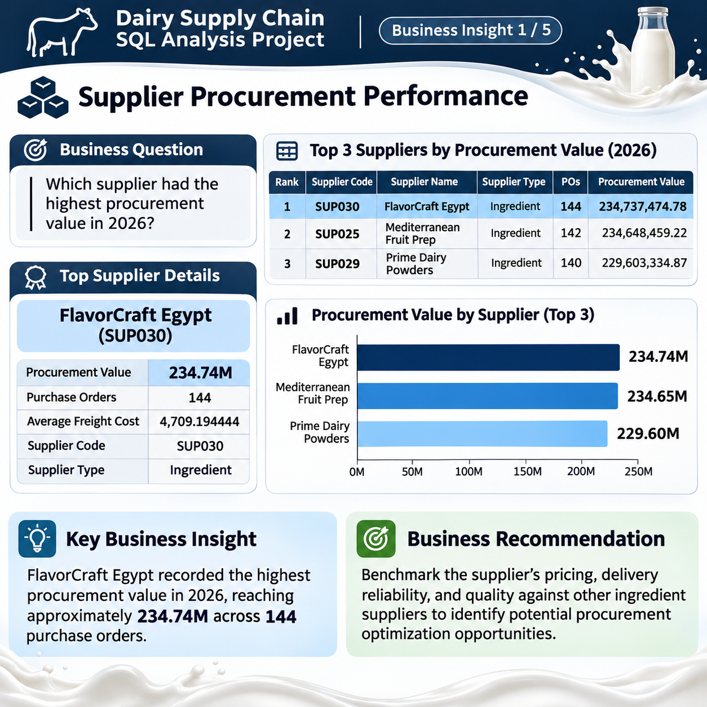
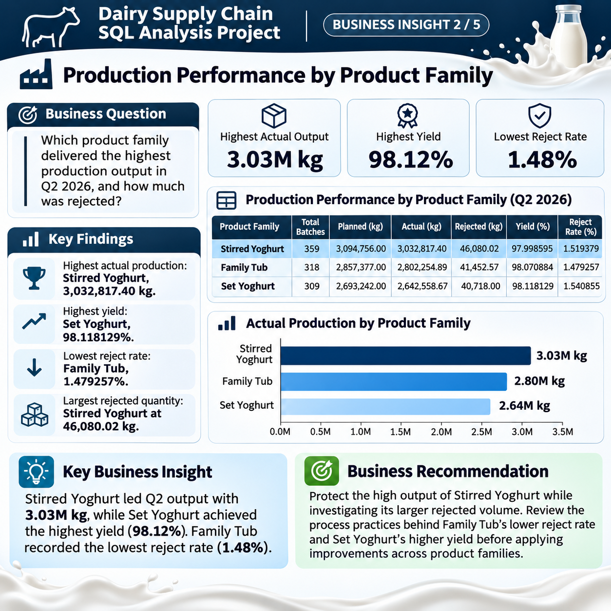
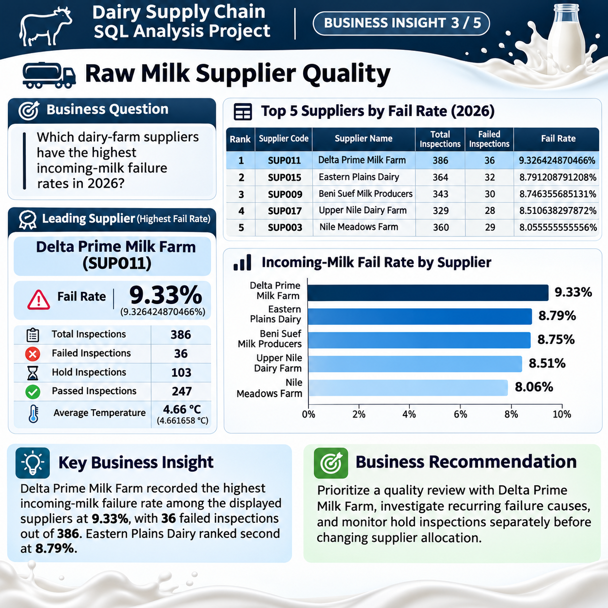
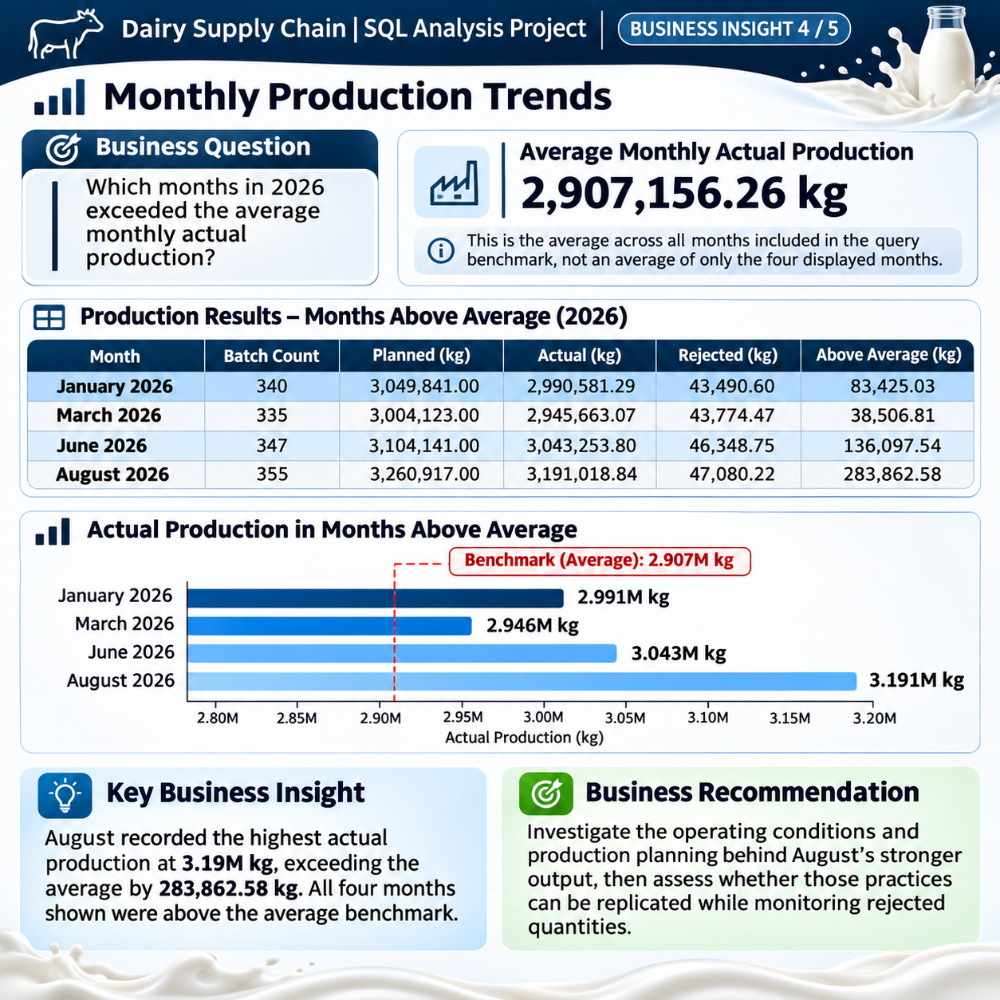
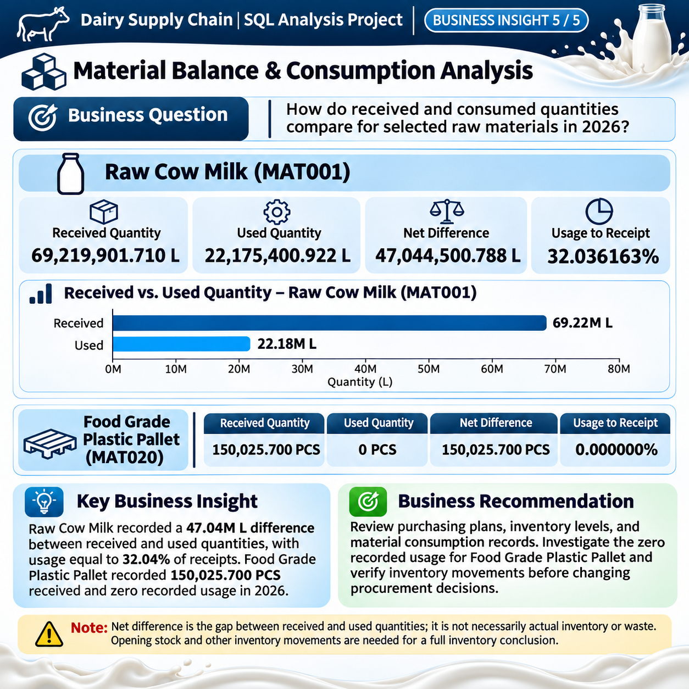

Dairy Supply Chain SQL Analysis

## Project Overview

**NileCult Dairy Factory – Supply Chain SQL Capstone**

This project focuses on analyzing the supply chain operations of a fictional Egyptian dairy manufacturing company using Microsoft SQL Server.

The goal is to transform structured operational data into meaningful business insights through database design, data loading, and SQL analysis.

## Project Objectives
- Design a relational database for dairy supply chain operations.
- Create and manage tables, relationships, and constraints.
- Generate and load synthetic operational data.
- Analyze procurement, suppliers, production, quality, and material usage.
- Answer business questions using SQL queries.
- Extract insights to support data-driven decision-making.

## Database Overview
The database is named `DairySupplyChainDB` and contains 10 related tables covering:

- Suppliers
- Materials
- Products
- Production Lines
- Purchase Orders
- Purchase Order Lines
- Production Batches
- Batch Material Usage
- Quality Inspections
- Dispatches

## Technical Skills & Tools
- Microsoft SQL Server
- T-SQL
- Database Design
- Data Definition Language (DDL)
- Data Manipulation Language (DML)
- Joins and Subqueries
- Aggregate Functions
- Common Table Expressions (CTEs)
- Window Functions
- Business Data Analysis

## Project Structure
The project is organized into the following sections:

- **Database:** Database creation and data loading scripts.
- **SQL-Analysis:** Analytical SQL queries and business analysis.
- **Business-Insights:** Visual summaries of key findings.
- **ER-Diagram:** Entity Relationship Diagram.
- **Documentation:** Project requirements and supporting documentation.

## Key Analysis Areas
The project explores several important business areas:

1. Supplier Procurement Performance
2. Production Performance
3. Raw Milk Supplier Quality
4. Monthly Production Trends
5. Material Balance Analysis

## Key Business Insights

This project explores five major areas of supply chain performance:

1. **Supplier Procurement Performance:** Analyzing supplier procurement value, purchase orders, and freight costs.
2. **Production Performance:** Comparing production quantities, yields, and rejection rates across products.
3. **Raw Milk Supplier Quality:** Evaluating inspection results and supplier failure rates.
4. **Monthly Production Trends:** Identifying monthly production patterns and peak production periods.
5. **Material Balance Analysis:** Comparing material quantities received against quantities used in production.
## Business Insights Visualizations

### 1. Supplier Procurement Performance

### 2. Production Performance

### 3. Raw Milk Supplier Quality

### 4. Monthly Production Trends

### 5. Material Balance Analysis

## Data Disclaimer
All data used in this project is synthetic and created for educational and analytical purposes. It does not represent actual company records.

## How to Use
1. Download the project ZIP file from this repository.
2. Extract the files.
3. Open Microsoft SQL Server Management Studio (SSMS).
4. Execute the database creation script.
5. Execute the data loading script.
6. Run the analytical SQL scripts to explore the results.

Author
Eng.moaz wael ezzat
Data Analyst | SQL Server | Data Analysis | T-SQL
---
This project was developed as a SQL Supply Chain Analytics Capstone Project.
